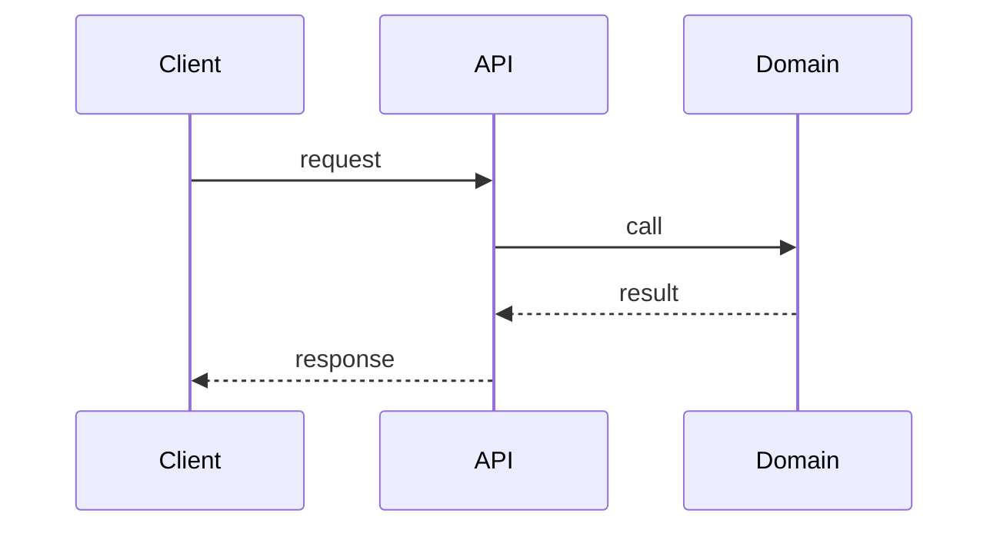

# Architecture

> Keep this to 1-2 pages. It is context for humans AND agents. Update it in the same PR that changes the architecture.

## 1. Purpose and context
<What the system does, who/what calls it, what it depends on. A C4 "system context" sentence or diagram.>

## 2. Building blocks
| Component | Responsibility | Location | Depends on |
|---|---|---|---|
| `<name>` | `<one line>` | `<path>` | `<components>` |

## 3. Key flows
<Describe 1-3 main flows as numbered steps or a Mermaid sequence diagram.>

## 4. Data
<Stores, schemas, ownership, retention, PII classification.>

## 5. Cross-cutting rules
- Layering: `<e.g. transport -> domain; domain never imports transport>`
- Errors, logging, config, auth: `<one line each>`
- Concurrency / consistency: `<model>`

## 6. Decisions
Link to `docs/adr/` records. Newest first.

## 7. Known debt and landmines
<Things that will bite an agent or a new engineer.>
